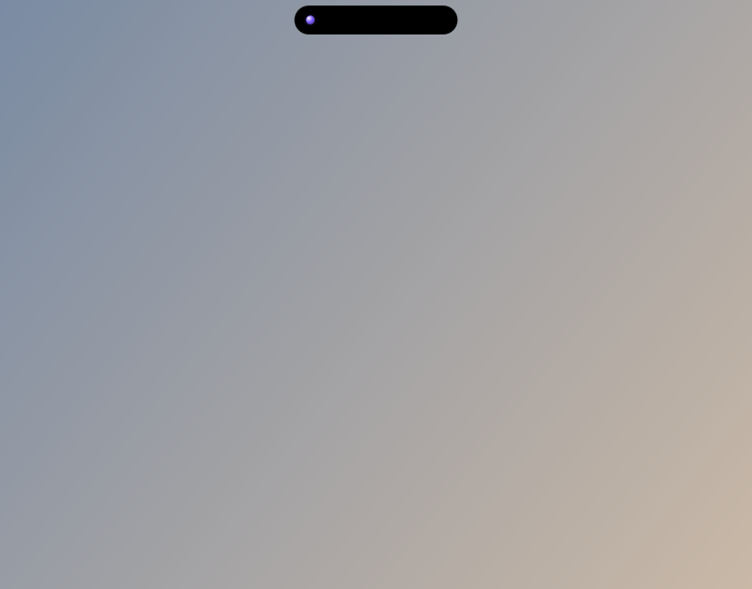

# Wisp

**A voice assistant for Windows 10/11, built on Google's Gemini Live API, with a Dynamic-Island-style overlay.**

Hold a key, talk, and Wisp answers out loud. It can also act on your PC: it opens and switches apps,
clicks buttons by name, types, searches the web, manages files, to-dos, reminders, routines and your
Google Calendar, controls volume and music, and answers questions about what's on your screen.


> **Why this project exists.** I built Wisp to see how far a current AI coding agent can go on a
> real, multi-week-sized desktop project. The whole codebase was written by **Claude Opus 5.5
> running in Claude Code**, working from a brief I wrote and directed. I set the requirements,
> reviewed each phase, ran the hands-on tests on my own PC with a real microphone and API key, and
> fed the bugs back. See [How it was built](#how-it-was-built).

---

## What it does

| Feature | What you do | What happens |
|---|---|---|
| **Talk** | Hold **Alt+Win** (or click the orb) | A live, interruptible voice conversation with Gemini, with tool calls to control the PC |
| **Dictation** | Hold **Ctrl+Win** and speak | Clean text (fillers and self-corrections removed) is typed into whatever box has focus |
| **Circle to Ask** | Hold **Ctrl+Shift** and draw a loop | Ask about anything you circled on screen, across monitors and DPI scales |
| **Screen Assist / Watch** | Hold **Ctrl+Alt+Space** | Ask about the window in front; Watch mode keeps an eye on it, with a privacy blocklist |
| **The Island** | Hover the pill at the top of the screen | A morphing overlay showing listening, thinking, speaking, music, countdowns and banners; opens into chat, controls, calendar, files, clipboard history, an app launcher and stats |
| **Discreet mode** | Hold **Ctrl+Alt+D** | Text-only answers and muted notifications for quiet places |
| **Routines and to-dos** | "Every weekday at 9, open Outlook and Teams" | Persistent scheduled tasks and reminders that survive restarts |
| **Memory** | "Remember that…" | Facts you can search, edit, pin and delete in Settings |

<p>
  
  
</p>

More recordings are in [docs/island](docs/island/README.md), and before/after UI screenshots are in
[docs/screenshots](docs/screenshots/README.md). The full feature and settings reference is the
**[user guide](docs/USER_GUIDE.md)**.

## Tech stack

- **Python 3.12**, **PySide6 (Qt 6)** for the tray app, Island, overlays and Settings
- **Google Gen AI SDK**: Gemini Live for real-time, two-way audio with tool calling; Gemini Flash for dictation clean-up and screen questions
- **Windows APIs** through pywin32, comtypes and WinRT: UI Automation, DWM/Mica, global keyboard hooks, media sessions, audio endpoints, radios, the share sheet and DPAPI
- **SQLite + SQLAlchemy** for memories, to-dos, clipboard history and stats; **APScheduler** for persistent routines
- **Google Calendar API** (OAuth desktop flow) for the calendar tab
- **pytest, pytest-qt and Ruff**, run in **GitHub Actions** on `windows-latest`; **PyInstaller + Inno Setup** for the installer

## Architecture at a glance

```
src/wisp/
├── live/        Gemini Live session: connect, stream mic audio, resume after GoAway/network drops
├── audio/       capture, resampling, playback, mic check
├── tools/       44 tools in 16 skill groups, a dispatcher, schemas and a safety layer
│                (confirmation cards for risky actions, an action log)
├── winapi/      thin wrappers over Win32 / UIA / WinRT
├── ui/          the Island, orb, overlays, console, Settings, theme tokens and motion
├── assist/      Screen Assist and Watch mode (capture → privacy filter → model)
├── gcal/        Google Calendar sync and store
├── scheduling/  routines and reminders
└── stores/      memory, to-dos, clipboard history, stats, usage
```

The API key is encrypted with Windows DPAPI and never logged. Everything Wisp stores stays on the PC
in `%APPDATA%\Wisp`.

## How it was built

Wisp is an experiment in **agentic software development**: I wanted to test what **Claude Opus 5.5**
can deliver end to end when it's given a real brief rather than a single coding question.

**My role:** I wrote the product brief and requirements, set the direction for each round of
features, reviewed every phase, ran the manual
test passes on my own Windows PC and reported what broke.

**The model's role (via Claude Code):** design, implementation, tests, documentation and packaging.

**How the work was organised:**

- **Phased delivery.** Phase 0 (setup and verified sources) through Phase 11 (final audit), one
  commit per phase, followed by feature briefs: the Island, Calendar, Files & Share, Screen Assist
  and Discreet mode. The history is 27 commits from 12–16 Oct 2026.
- **Written decisions.** [DECISIONS.md](DECISIONS.md) records 55 design decisions with their
  reasons, including every place Wisp relies on undocumented Windows behaviour.
- **Verified sources.** [SOURCES.md](SOURCES.md) lists every API and document the code depends on,
  checked against the pinned dependency versions.
- **Evidence-based progress.** [PROGRESS.md](PROGRESS.md) maps each requirement to its evidence (a
  test, a spike or a build). [MANUAL_TESTS.md](MANUAL_TESTS.md) holds the hands-on checks that need
  a person, a microphone or real hardware.
- **Spikes before features.** The `spikes/` folder holds the small probes used to de-risk Windows
  APIs (UI Automation, WinRT, Mica, keyboard hooks) before building on them.

**By the numbers:** about 24,000 lines of Python in 170 modules, about 10,000 lines of tests in 49
files, and a CI pipeline that lints, tests and builds the installer. At the
[final audit](FINAL_REPORT.md), 312 tests passed and 3 opt-in tests were skipped.

**What testing it with real use showed:**

- **The model was strong** at large-scale structure, Windows API plumbing, writing tests alongside
  code, and keeping its own documentation honest. The final audit caught and fixed real bugs, such
  as a Qt virtual-method clash and clipboard monitors outliving their database.
- **Hands-on testing still mattered.** Some bugs only appeared on real hardware: an 81 ms tap of the
  talk key sent an empty audio turn that Google rejected, and a silent microphone went undetected.
  Both were found in manual testing and fixed afterwards (decisions D-038, D-054 and D-055).

## Run it from source

```powershell
git clone https://github.com/Mathias-D06/Wisp.git
cd Wisp
py -3.12 -m venv .venv
.venv\Scripts\pip install -e ".[dev]"
.venv\Scripts\python -m wisp
```

Add a Gemini API key in **Settings → General** (create one at <https://aistudio.google.com/api-keys>).
UK, EEA and Swiss users need a billing-enabled key under Google's terms. To build the installer, run
`.venv\Scripts\python packaging\build.py`. Full details are in the [user guide](docs/USER_GUIDE.md#building-from-source).

## Status and limitations

Version 0.1.1, a personal project. The installer isn't code-signed, so SmartScreen warns on first run.
Some system toggles (Night Light, dark mode, default output device) use undocumented Windows
behaviour; each one is isolated and fails gracefully (see [FINAL_REPORT.md](FINAL_REPORT.md)).
Wisp is released under the [MIT License](LICENSE). Third-party licences are listed in the build's
`THIRD_PARTY_NOTICES.txt`.
